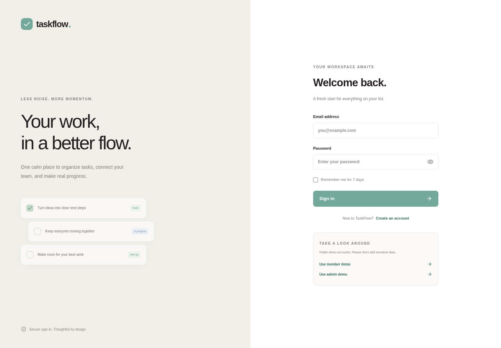
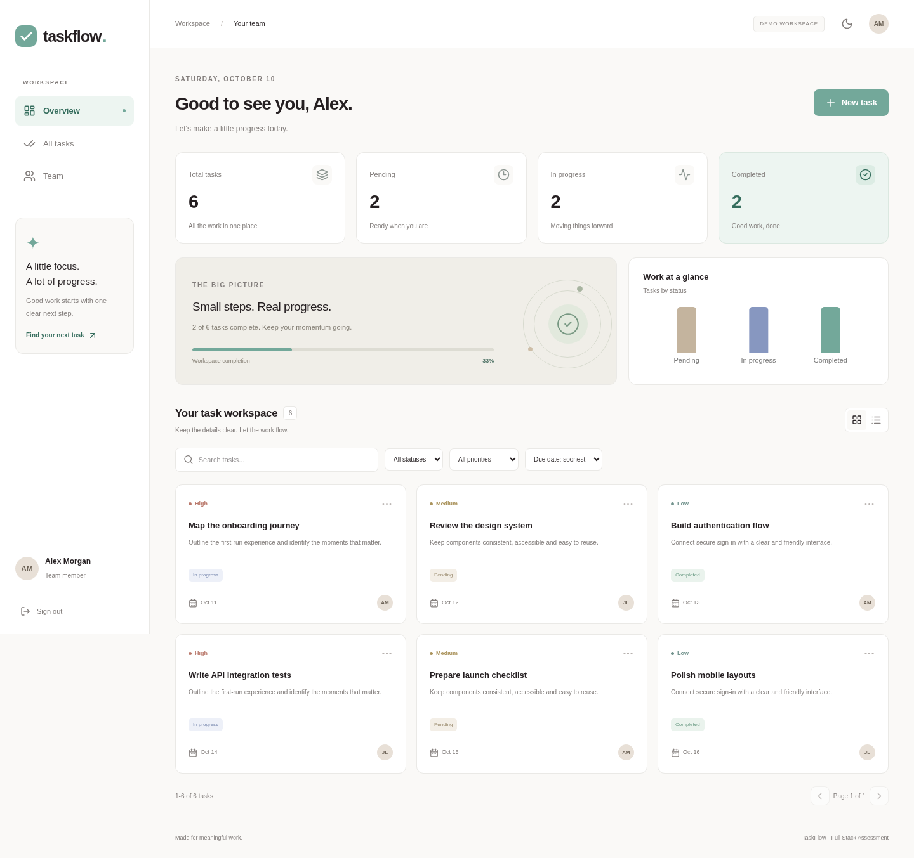
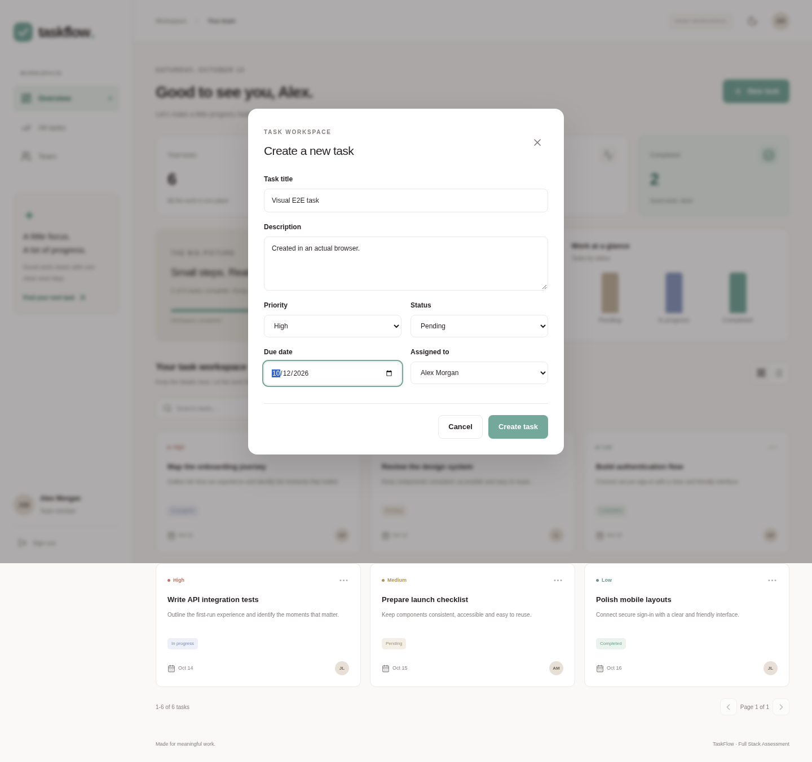
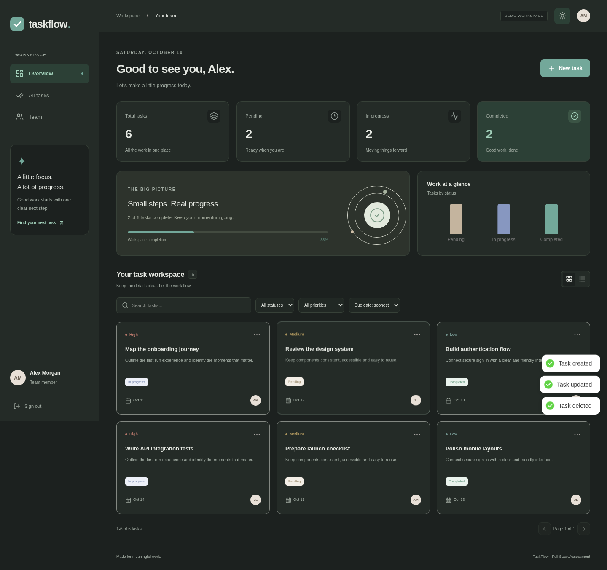
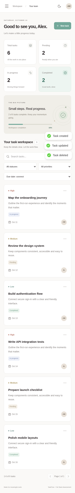

# TaskFlow

A calm, responsive task and team workspace built for the Full Stack Intern assessment. Organize your work, assign teammates, and see progress without losing the details.

## Live deployment

Deployment is in progress. Live URLs will be added after verification. Do not treat the local build as a live deployment.

## Demo accounts

| Role   | Email                | Password   |
| ------ | -------------------- | ---------- |
| Member | testuser@example.com | Test@1234  |
| Admin  | admin@example.com    | Admin@1234 |

These are intentionally public assessment fixtures, not real account passwords. Do not enter sensitive data into this demo. Set `SEED_DEMO=true` to seed them on first server startup. Seeding is idempotent and does not reset existing passwords or delete data.

## Features

- Register, login, logout, JWT, bcrypt password hashing, protected pages and remember me.
- Dashboard: total, pending, in-progress and completed counts.
- Create, view, edit and delete tasks with title, description, priority, due date, status and assignee.
- Debounced title search, status and priority filters, date sorting and server-side pagination.
- Team directory, role-based task access and admin controls.
- Accessible modal focus management, keyboard controls, loading skeletons, empty states, network errors and retry.
- Responsive phone navigation, grid/list views and reduced-motion support.

### Bonus features

1. Dark mode with saved preference.
2. Server-side pagination.
3. Task-status charts and completion visualization.
4. Toast notifications.
5. Unit/integration tests (9 passing scenarios).
6. Docker backend image.

The browser test also checks registration, login, create/edit/delete, team, logout, dark mode, console errors and mobile horizontal overflow.

## Tech stack

React 19, Vite, React Router, Axios, Redux Toolkit, Tailwind CSS, Lucide icons, Recharts, React Hot Toast, Node.js 22, Express 5, Mongoose, MongoDB Atlas, bcryptjs, JWT, Zod, Helmet and express-rate-limit. Deployment targets: Vercel (frontend), Render (backend), Atlas (database).

## Local setup

Prerequisites: Node.js 22+, npm and a MongoDB database (local or Atlas).

```bash
npm --prefix server ci
npm --prefix client ci
cp server/.env.example server/.env
cp client/.env.example client/.env
# Edit server/.env: MONGODB_URI, JWT_SECRET, CLIENT_URL.
# Set VITE_API_URL in client/.env.
npm --prefix server run dev
# In another terminal:
npm --prefix client run dev
```

Frontend: `http://localhost:5173`. API: `http://localhost:4000`.

```bash
npm test      # runs 9 API tests with an isolated in-memory MongoDB
npm install
npx playwright install chromium
npm run test:e2e # browser registration/login/CRUD/team/theme/mobile
npm run build
npm --prefix server run seed  # optional explicit demo seeding
```

The test runner downloads a MongoDB binary on its first run. Never point tests at a production database.

## Folder structure

```text
client/src/
  components/   Layout, memoized TaskCard, TaskModal
  pages/        Auth, Dashboard, Team (lazy loaded)
  hooks/        useTasks, useDebounce
  services/     Axios API and error mapping
  utils/        Date, status and avatar helpers
  store/        Redux authentication state
server/
  controllers/  Authentication and task operations
  models/       User and Task Mongoose models
  routes/       JSON REST API routing
  middleware/   JWT verification
  config/       Database connection
  tests/        API and authorization tests
  app.js        Express middleware and errors
  index.js      Startup and optional seed
  seed.js       Public assessment fixtures
  Dockerfile
```

## REST API

All requests and responses use JSON. Protected endpoints require `Authorization: Bearer <token>`. Import `docs/TaskFlow.postman_collection.json` into Postman. Set `baseUrl`, run Login to capture the JWT/user ID, then Create task to capture the task ID.

| Method | Endpoint     | Request / result                                |
| ------ | ------------ | ----------------------------------------------- |
| POST   | `/register`  | `{name,email,password}` → 201 `{user,token}`    |
| POST   | `/login`     | `{email,password,rememberMe?}` → `{user,token}` |
| GET    | `/tasks`     | `{tasks,total,page,pages,stats}`                |
| GET    | `/tasks/:id` | `{task}`                                        |
| POST   | `/tasks`     | Complete task body → 201 `{task}`               |
| PUT    | `/tasks/:id` | Complete task body → `{task}`                   |
| DELETE | `/tasks/:id` | `{message:"Task deleted."}`                     |
| GET    | `/me`        | `{user}`                                        |
| GET    | `/users`     | `{users:[...]}`                                 |
| GET    | `/health`    | `{status:"ok",service:"taskflow-api"}`          |

Example task body:

```json
{
  "title": "Ship the assessment",
  "description": "Verify the deployed application",
  "priority": "high",
  "dueDate": "2026-10-12",
  "status": "in-progress",
  "assignedUser": "<user MongoDB ObjectId>"
}
```

`GET /tasks` query parameters: `search` (title, case-insensitive, escaped), `status` (`pending`, `in-progress`, `completed`), `priority` (`low`, `medium`, `high`), `sort` (`due`, `newest`, `oldest`), `page` (1-based), `limit` (1-50).

Stats reflect all tasks accessible to the user, not only filtered results. `due` and `oldest` sort by due date ascending; `newest` sorts by creation date descending. Task responses populate the assignee's name/email and creator's name.

Error format: `{ "message": "Human-readable error" }`. Codes: 400 invalid input/duplicate email, 401 missing/expired/invalid JWT or invalid credentials, 403 insufficient edit/delete permission, 404 missing endpoint/task, 429 login rate limit, 500 sanitized internal error.

### Authentication and access

Password rules: 8-72 characters, uppercase, lowercase, number and symbol. Password hashes use bcrypt with cost 12 and are excluded from queries by default. Email addresses are normalized and uniquely indexed. Register never accepts an admin role from the client.

Members see tasks they created or are assigned to; only the creator/admin may edit or delete. Admins see and manage all demo workspace tasks. The directory exposes names, emails and roles to signed-in users for assignment, so use the demo only with non-sensitive test data.

JWT lifetime: 8 hours normally, 7 days with Remember Me. Normal sessions use sessionStorage; remembered sessions use localStorage. Logout clears browser storage. Tokens are not server-revoked on logout and remain valid until expiry if copied; production should use HttpOnly cookies plus a revocation/rotation strategy. CORS restricts allowed browser origins, Helmet sets security headers, and auth endpoints are rate limited.

## React concepts

- `useState`: forms, filters, modal, view and theme.
- `useEffect`: API reads, debounce, session checks and saved theme.
- `useMemo`: stable filter parameters and derived chart values.
- `useCallback`: stable task actions and modal handlers.
- `React.memo`: task cards avoid unrelated rerenders.
- Custom hooks: `useTasks` encapsulates API state and CRUD; `useDebounce` delays search.
- Redux Toolkit: authentication state.
- `React.lazy` + `Suspense`: route-level chunks and loading feedback.

## Deployment guide

1. Create an Atlas free cluster with a dedicated least-privilege database user. Configure network access for the backend and store the URI only in Render environment variables.
2. Import this repo in Render as a Node web service, root `server`, build `npm ci --omit=dev`, start `npm start`, health check `/health`, free plan.
3. Set `MONGODB_URI`, a random `JWT_SECRET` (32+ characters), `CLIENT_URL` (frontend origin), `SEED_DEMO=true`, `NODE_VERSION=22`. Render sets `PORT`.
4. Import in Vercel, root `client`, framework Vite, build `npm run build`, output `dist`, `VITE_API_URL=<Render URL>`.
5. Update Render `CLIENT_URL` to the exact Vercel production origin. Redeploy, then verify registration, both demo logins and create/view/update/delete.
6. Free Render instances can sleep and take around a minute to wake; the frontend displays a note during slow sign-in and uses a 60-second timeout. No paid resources are needed.

`render.yaml` supplies the backend configuration. `client/vercel.json` supplies SPA deep-link rewrites. Never commit `.env`, database passwords, access tokens or provider credentials.

## Screenshots

Screenshots below are of the locally running app, verified in a real browser. Live deployment verification is still pending.







## Assessment scope

This is a single demo workspace, not a production multi-tenant product. Email verification, private workspace invitations and server-side token revocation are not implemented. No sensitive personal data is included in the seed.
